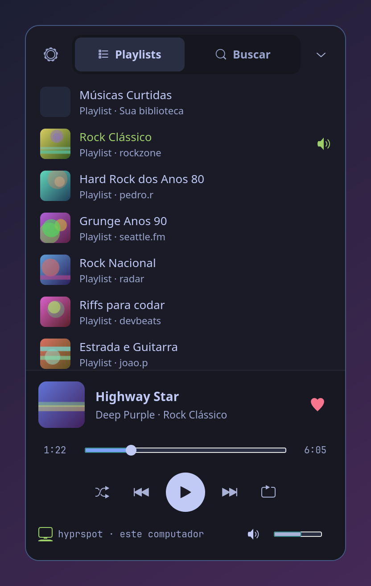
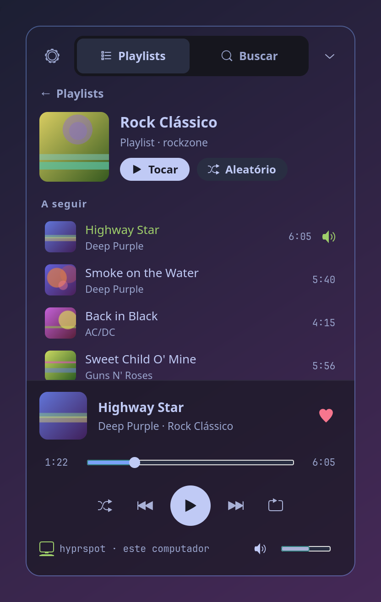
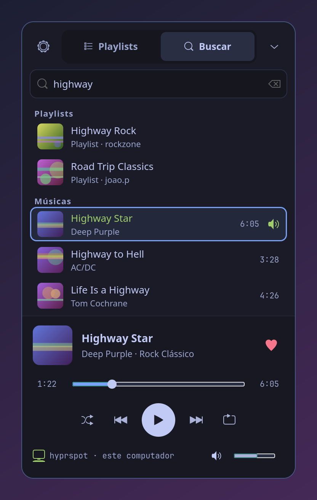
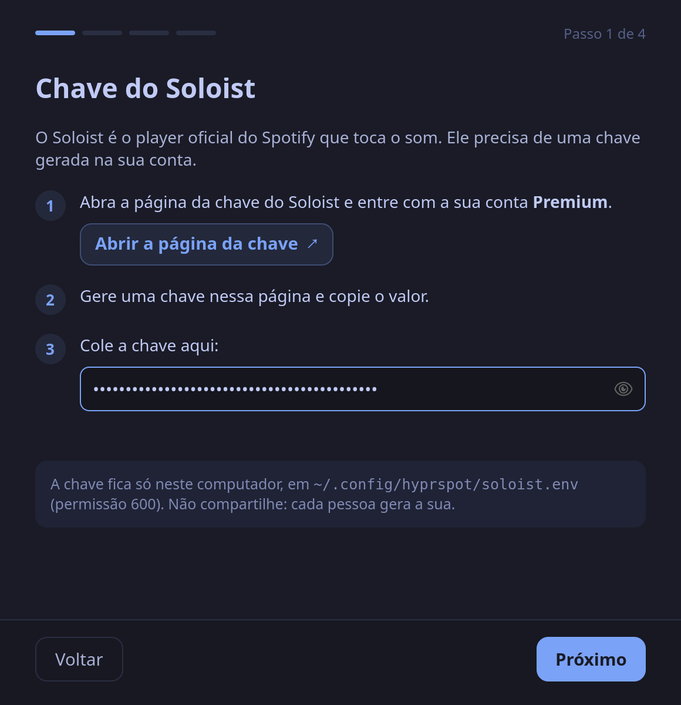
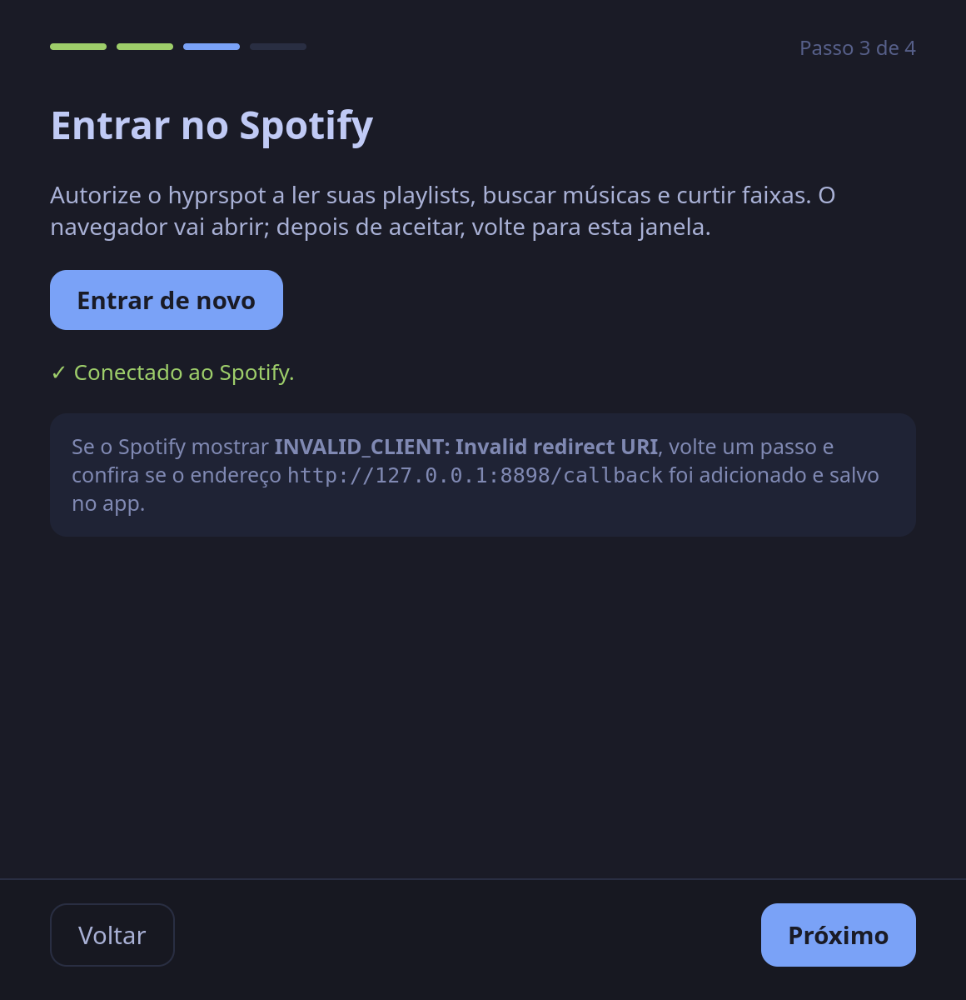
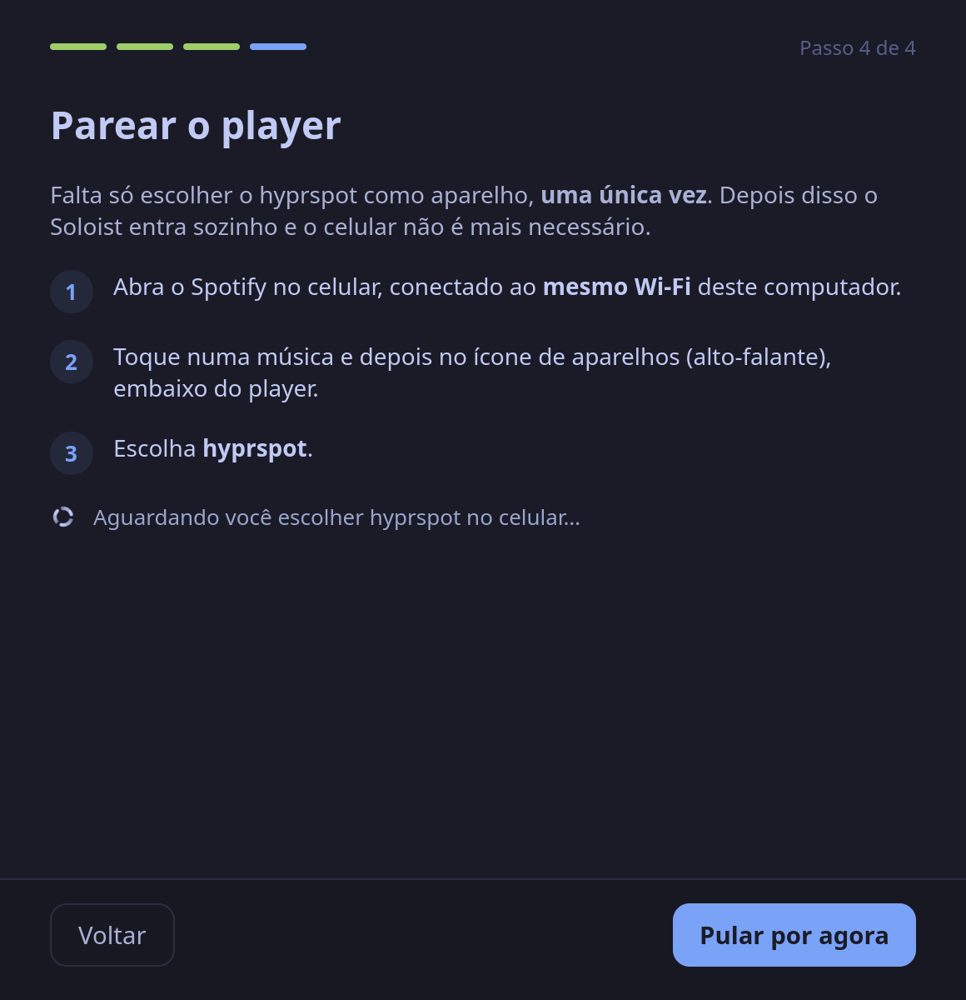
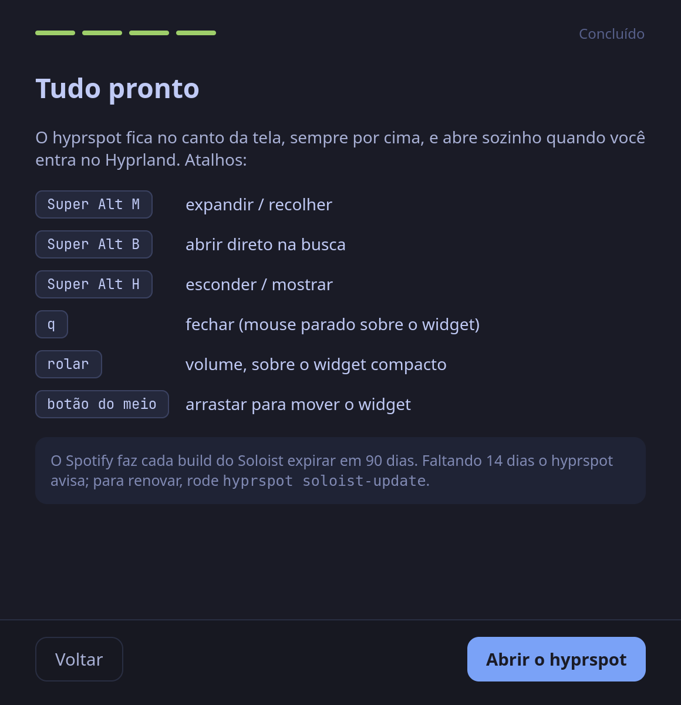

# hyprspot

Mini player de Spotify para o Hyprland. Fica sempre por cima, num canto da tela, com os controles a um clique. Quando você precisa de mais, ele expande e mostra suas playlists e uma busca. Ao clicar fora, volta ao tamanho mínimo.

<p align="center">
  
</p>
<p align="center">
  
  &nbsp;
  
  &nbsp;
  
</p>

- **Compacto (320×64):** capa, faixa, artista, anterior / play / próxima e barra de progresso. Para ajustar o volume, role o mouse sobre ele.
- **Expandido (360×600):** playlists, a tela de cada playlist com a fila "A seguir", busca de músicas e playlists conforme você digita, curtir, aleatório, repetir, posição da música e volume.
- **Rápido:** os comandos vão direto para o player local e respondem em cerca de 15 ms. Os botões não esperam a resposta do Spotify para mudar na tela.
- **Discreto:** não rouba o foco das outras janelas, recolhe sozinho quando você clica fora e pode ser arrastado para qualquer canto.

## Como funciona

O som sai pelo **[Spotify Soloist](https://developer.spotify.com/documentation/soloist)**, o player oficial do Spotify sem janela, que roda como serviço do usuário. O hyprspot conversa com ele por um WebSocket local (`127.0.0.1:9090`). Playlists, busca e curtidas vêm da **Web API** do Spotify, com login PKCE, sem *client secret*.

Por isso a configuração pede duas coisas, as duas gratuitas e só suas: uma **chave do Soloist** e um **app da Web API**. A tela de configuração guia as duas.

## Requisitos

- Hyprland 0.53 ou mais novo
- conta **Spotify Premium** (veja abaixo por quê)
- processador x86_64 ou arm64 (o Spotify só publica o Soloist para esses dois)
- Python 3.11+, GTK 4, gtk4-layer-shell e libsoup 3. O instalador cuida disso em distros com `apt` (Ubuntu, Debian), `pacman` (Arch, Omarchy) ou `dnf` (Fedora).

### Por que Premium?

O Premium é exigido em dois pontos da configuração:

- **Soloist:** a chave de API do Soloist precisa ser criada por uma conta Premium. Depois que ele está rodando, contas Free e Premium conseguem se conectar e tocar ([anúncio do Spotify](https://developer.spotify.com/blog/2026-08-13-introducing-spotify-soloist)).
- **Web API:** o app usado para playlists, busca e curtidas fica em modo de desenvolvimento, e o dono desse app precisa ter Premium.

Na prática, quem tem Premium configura e usa tudo sozinho. Com uma conta Free, em teoria daria para usar se alguém com Premium criasse a chave do Soloist e o app da Web API e autorizasse a sua conta no app. Isso não foi testado.

## Instalação

```bash
git clone https://github.com/eduPHP/hyprspot.git ~/.local/share/hyprspot
~/.local/share/hyprspot/setup.sh
```

O `setup.sh` faz o seguinte, em ordem:

1. **Dependências:** mostra os pacotes que faltam e pede confirmação antes de usar o `sudo`. Se já estiver tudo instalado, pula.
2. **Hyprland:** cria `~/.config/hypr/hyprspot.conf` com os atalhos, o autostart e as regras de janela, e acrescenta ao `hyprland.conf` um bloco com o `source`. Antes de mudar qualquer arquivo, faz um backup `.bak.hyprspot.<data>`.
3. **Soloist:** instala o serviço `soloist.service` e baixa o build oficial direto do Spotify. O binário não pode ser redistribuído, então cada computador baixa o seu.
4. **Conta:** abre a tela de configuração, descrita abaixo.

Opções:

| Comando | O que faz |
|---|---|
| `./setup.sh -y` | instala sem perguntar antes do `sudo` |
| `./setup.sh --check` | só confere as dependências |
| `./setup.sh --print-deps apt` | lista os pacotes (também `pacman` e `dnf`) |
| `./setup.sh --remove` | remove atalhos, autostart e links, e mantém o Soloist e seus tokens |

## Configuração da conta

A tela abre sozinha no fim da instalação. Para abri-la de novo a qualquer momento, rode `hyprspot setup`. Ela tem quatro passos e leva uns 5 minutos. Mantenha o navegador logado em [developer.spotify.com](https://developer.spotify.com) com a sua conta Premium.

<table>
<tr>
<td width="50%"></td>
<td width="50%"></td>
</tr>
<tr>
<td valign="top">

**1. Chave do Soloist.** O botão abre [developer.spotify.com/dashboard/soloist](https://developer.spotify.com/dashboard/soloist). Gere a chave, copie e cole no campo. A chave fica só em `~/.config/hyprspot/soloist.env`, com permissão 600, e o serviço do Soloist sobe na hora.

</td>
<td valign="top">

**2. App da Web API.** O botão abre a [criação de app](https://developer.spotify.com/dashboard/create). Preencha assim:
- **App name:** `hyprspot`;
- **App description:** qualquer texto;
- **Redirect URIs:** `http://127.0.0.1:8898/callback` (o botão "Copiar" ajuda), depois clique **Add**;
- **Which API/SDKs:** marque **Web API**, aceite os termos e clique **Save**.

Por fim, abra **Settings** e cole o **Client ID** no campo. É o Client ID, não o *Client secret*.

</td>
</tr>
<tr>
<td></td>
<td></td>
</tr>
<tr>
<td valign="top">

**3. Entrar no Spotify.** O navegador abre a autorização do Spotify. Depois de aceitar, volte para a janela, que mostra "Conectado".

</td>
<td valign="top">

**4. Parear o player.** No celular, no **mesmo Wi-Fi**, abra o Spotify, toque no ícone de aparelhos e escolha **hyprspot**. A tela percebe sozinha quando o pareamento acontece. Isso é feito **uma única vez**: depois, o Soloist entra na sua conta sozinho, sem o celular.

</td>
</tr>
</table>

<p align="center">
  
</p>

## Uso

| Ação | Como |
|---|---|
| Expandir / recolher | `Super+Alt+M`, ou clique na capa ou no título |
| Abrir direto na busca | `Super+Alt+B` |
| Abrir uma playlist | clique nela, na lista ou na busca: ela começa a tocar e abre a tela dela, com "Tocar", "Aleatório" e a fila "A seguir". Clique numa música da fila para tocar a playlist a partir dela. Se a playlist já estiver tocando, só abre a tela. |
| Esconder / mostrar | `Super+Alt+H` |
| Volume | rolar o mouse sobre o widget compacto |
| Mover o widget | arrastar o compacto com o botão esquerdo (no touchpad, um dedo) ou qualquer modo com o botão do meio. Ele passa de um monitor para outro seguindo o cursor, não sai da área visível, e a posição (e o monitor) ficam salvos. |
| Fechar o hyprspot | `q` com o mouse parado sobre o widget, ou no expandido fora da busca. A música continua tocando. |
| Teclado no compacto | com o mouse parado sobre o widget: `Espaço` toca/pausa, `←` `→` trocam de faixa, `q` fecha |
| Teclado no expandido | `Esc` volta da tela da playlist e, na lista, recolhe; `Tab` troca de aba, `/` vai para a busca, `Espaço` toca/pausa, `←` `→` trocam de faixa (fora da busca), `↑` `↓` e `Enter` nos resultados |
| Teclas de mídia e de volume | continuam com o sistema; o hyprspot não mexe nelas. Use o widget (ou os atalhos acima) para controlar o Soloist |

Comandos de terminal: `hyprspot toggle | expand [--search] | collapse | hide | show | quit | play-pause | next | prev | setup | login | soloist-status | soloist-update`.

Para integrar a outros painéis (Waybar, eww etc.):
- `hyprspot-ctl open-close` abre ou fecha o app;
- `hyprspot-ctl media play-pause|next|prev` controla o Soloist mesmo com o hyprspot fechado.

### Ajustes

Em `~/.config/hyprspot/config.toml`:

```toml
anchor = "bottom-right"     # top-left | top-right | bottom-left | bottom-right
margin = [16, 16]           # distância da borda (o arraste grava aqui)
monitor = ""                # conector, ex. "HDMI-A-1"; vazio = o monitor focado ao abrir (o arraste grava aqui)
collapse_delay_ms = 150     # espera antes de recolher ao perder o foco
```

Os atalhos ficam em `~/.config/hypr/hyprspot.conf`. Esse arquivo é recriado sempre que você roda o instalador. Para trocar uma tecla, use `unbind` e `bind` num arquivo seu, carregado depois dele.

## Renovação a cada 90 dias

O Spotify faz cada build do Soloist expirar 90 dias depois de gerado. Faltando 14 dias, o modo expandido mostra um aviso. Para ver a validade e para atualizar:

```bash
hyprspot soloist-status
hyprspot soloist-update
```

O `soloist-update` baixa o build oficial, confere que ele roda, troca o `~/.local/bin/soloist` e reinicia o serviço.

## Problemas comuns

| Sintoma | O que fazer |
|---|---|
| "Pareamento pendente" ou o hyprspot não aparece no celular | Confira que o celular está no mesmo Wi-Fi e que o serviço está rodando: `systemctl --user status soloist`. O log fica em `journalctl --user -u soloist`. |
| "Soloist expirou" | `hyprspot soloist-update` |
| `INVALID_CLIENT: Invalid redirect URI` no login | No app do painel, adicione exatamente `http://127.0.0.1:8898/callback` em Redirect URIs e clique em Save. |
| "A porta 8898 está ocupada" no login | Feche o outro programa que usa a porta e tente de novo. |
| Playlists ou busca não carregam | Rode `hyprspot setup` e entre de novo no passo 3. Se a mensagem falar em cota, espere alguns minutos: apps em modo de desenvolvimento têm limite de chamadas. |
| Teclas de mídia não controlam o hyprspot | É esperado: elas ficam com o sistema, e o Soloist não aparece para o `playerctl`. Use o widget ou os atalhos `Super+Alt`. |

Para desinstalar: `./setup.sh --remove`. Para apagar também o Soloist e as credenciais:

```bash
systemctl --user disable --now soloist.service
rm -f ~/.config/systemd/user/soloist.service ~/.local/bin/soloist
rm -rf ~/.config/hyprspot ~/.cache/hyprspot
```

## Bugs conhecidos

| Bug | Detalhes |
|---|---|
| "Próxima" às vezes pula mais de uma música | Defeito do Soloist, não do hyprspot: o widget manda um único comando por clique. Depois de avançar, o Spotify às vezes nega a licença da faixa (`playback_error_drm_denied`), e o Soloist pula para a seguinte sozinho. Acontece também com `soloist ctl next`. Quando isso acontece, o widget avisa qual faixa foi pulada. Reportado em [spotify/soloist#40](https://github.com/spotify/soloist/issues/40). |

## Privacidade e uso

- A chave do Soloist, o Client ID e o token de login ficam só em `~/.config/hyprspot/`, a chave com permissão 600.
- O WebSocket do Soloist escuta apenas em `127.0.0.1`.
- Cada pessoa usa a própria chave e o próprio app.
- O hyprspot é para uso pessoal: a [política de desenvolvedor do Spotify](https://developer.spotify.com/policy) proíbe uso comercial.

## Desenvolvimento

```bash
python3 -m pytest -q      # testes (os de interface precisam de uma sessão Wayland)
bin/hyprspot              # roda direto do repositório
bin/hyprspot setup        # a tela de configuração
python3 scripts/make_screenshots.py   # refaz as imagens do README, com dados fictícios
```

Documentação de apoio:
- especificação: `docs/specs/2026-11-18-hyprspot-design.md`
- plano de implementação: `docs/superpowers/plans/2026-11-18-hyprspot.md`
- comparação dos players avaliados: `reports/Alternativas de áudio Spotify Linux.md`

## Licença

[MIT](LICENSE). O Spotify Soloist não faz parte deste repositório: cada instalação baixa o build oficial do Spotify, sujeito aos termos do Spotify.
